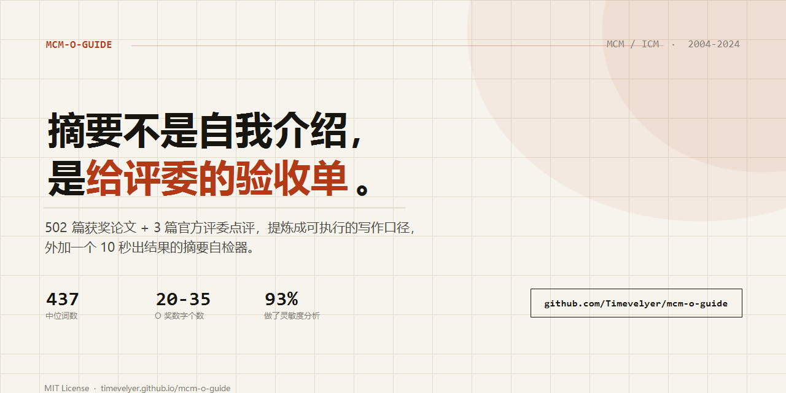

# MCM/ICM Award-Winning Paper Writing Guide · mcm-o-guide

[简体中文](README.md) · **English**

[](https://github.com/Timevelyer/mcm-o-guide/stargazers)
[](LICENSE)
[](references/top-award-strategy.md)
[](https://timevelyer.github.io/mcm-o-guide/)



> The initial screen takes under five minutes. Judges look for three things: **a quantitative conclusion for every task, the method chain, and the name of your model.**
> This guide turns 502 award-winning papers (2004–2024) and three official judges' commentaries into something you can actually write from.

**Online tools (nothing to install)**

- **[Summary checker](https://timevelyer.github.io/mcm-o-guide/en/)** — paste a summary, get a report in ten seconds · [中文](https://timevelyer.github.io/mcm-o-guide/)
- **[One-page cheat sheet](https://timevelyer.github.io/mcm-o-guide/cheatsheet.html)** — summary skeleton, page budget, pre-submission checks; print it on A4 (Chinese)

---

## What it fixes

| What you're stuck on | What's here |
|---|---|
| Your summary is a page of background and methods, with no numbers | A 10-sentence template + sentence-by-sentence breakdowns of 5 Outstanding summaries |
| You don't know what goes on each of the 25 pages, or how many figures | Page-budget table (to the half page) + median figure quotas for problem types A–F |
| The model is built; you're not sure it's deep enough | Model matrix, baseline recommendations and validation for 6 problem types |
| Your sensitivity section is one vague paragraph | Three patterns + what the 93% of O/F/M papers that did it actually did |
| Something feels inconsistent before you submit | Checklists for assumptions / numbers / structure / task coverage |
| You want to know what separates Meritorious from Outstanding | An 8-dimension comparison table, every row backed by a median |

## Three ways to use it

**1. Install as an agent skill (recommended)** — invoked automatically when you draft, revise or check a paper

```bash
npx skills add Timevelyer/mcm-o-guide
```

This detects and installs into whichever agents you have (OpenCode, Claude Code, Codex, Cursor and 75+ more) in one command. Node 22.20+. Prefer manual?

```bash
git clone https://github.com/Timevelyer/mcm-o-guide.git
mv mcm-o-guide ~/.config/opencode/skills/mcm-o-guide   # OpenCode
mv mcm-o-guide ~/.claude/skills/mcm-o-guide            # Claude Code
```

The skill entry point is `SKILL.md` (Chinese); the English edition is [`SKILL.en.md`](SKILL.en.md).

**2. Read it as a handbook** — start at [SKILL.en.md](SKILL.en.md), locate the right file with the "when to use" table in [GUIDE.en.md](GUIDE.en.md).

**3. Just run the tools** — no reading required:

```bash
node scripts/extract-pdf.mjs paper.pdf paper.txt   # PDF -> page-marked plain text
node scripts/check-paper.mjs paper.txt             # consistency: numbers / assumptions / figures / citations
node scripts/parameter-sweep.mjs                   # sensitivity: parameter sweep + ranking
node scripts/benchmark-paper.mjs                   # benchmark scoring against top papers
```

Node.js 18+; only `extract-pdf.mjs` needs `npm install pdfjs-dist`.

## What's inside

```
mcm-o-guide/
├── SKILL.md            # main skill: 13 chapters, judge mechanics -> sentence bank
├── SKILL.en.md         # English edition of the skill file
├── 使用指南.md          # scenario quick-reference (which file to open)
├── GUIDE.en.md         # English edition of the guide
├── references/         # 23 topic files: summary templates / model matrix / judges' notes / cases
├── playbooks/          # upskilling for modeller, coder, writer, researcher
├── templates/          # LaTeX + Markdown paper skeletons
└── scripts/            # 4 automation scripts
```

Start with these:

- [references/summary-template.md](references/summary-template.md) — template + breakdowns of 5 Outstanding summaries
- [references/model-matrix.md](references/model-matrix.md) — model matrix for 6 problem types
- [references/page-by-page.md](references/page-by-page.md) — 25-page dissection
- [references/checklist.md](references/checklist.md) — pre-submission consistency checklist
- [references/common-errors.md](references/common-errors.md) — catalogue of what not to do

## Data basis

| Metric | Source |
|---|---|
| Corpus statistics (449 valid papers) | 502 PDFs extracted and analysed by the author |
| Judges' commentaries | COMAP official: 2009 A/B, 2021 Tips |
| Page budget / figure quotas | Median of 2021–2024 Outstanding papers |
| Summary breakdowns | Sentence-level analysis of 5 Outstanding papers |

> **Note**: this repository does not replace the current-year COMAP rules. Before submitting, verify that year's page limit, file format, submission method, AI-use policy and anonymity requirements.

## FAQ

**Will these numbers go stale?**
The structure is stable; page budgets and figure quotas drift slightly year to year. After each contest I add the new Outstanding analysis and bump the version — see `CHANGELOG.md`.

**Does it work for CUMCM (the Chinese contest)?**
The judging mechanics and page rules differ, but summary structure, figure interpretation, sensitivity patterns and consistency checks transfer. Don't apply the 25-page budget directly.

**Can I reuse it commercially?**
MIT. Keep the attribution and you're fine.

**Something looks wrong?**
Open an [Issue](https://github.com/Timevelyer/mcm-o-guide/issues/new/choose) with a source or a reproduction.

## Contributing

- Tell us which line actually saved you — that feedback shapes the next version
- Real Outstanding / Finalist paper breakdowns are welcome as PRs
- A ★ Star is enough: it's how the next team finds this

## License

[MIT](LICENSE). Docs may be republished with attribution; keep the repository link for commercial use.

---

If this saved you one mistake, hit **[★ Star](https://github.com/Timevelyer/mcm-o-guide)** — it's the only way the next team finds it.
